<div align="center">


# Smart Emailing

**Pelatihan interaktif menulis email lamaran kerja yang rapi, sopan, dan profesional untuk fresh graduate.**

Media pembelajaran berbasis web · Kelompok 7

[](https://syahladfa.github.io/SmartEmailing/)
[](https://github.com/syahladfa/SmartEmailing/releases/latest)


**[Buka web](https://syahladfa.github.io/SmartEmailing/)** · **[Unduh rilis terbaru](https://github.com/syahladfa/SmartEmailing/releases/latest)** · [Versi offline](dist/SmartEmailing_Tim7_offline.html) · [Paket SCORM](dist/SmartEmailing_Tim7_SCORM.zip)

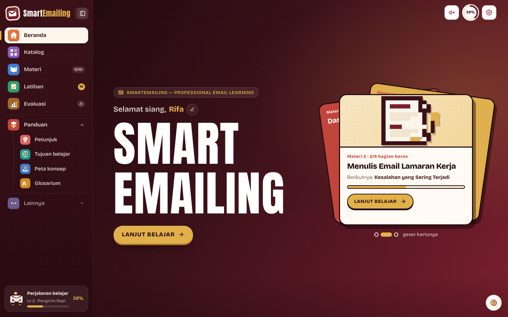

</div>

## Sekilas

Banyak lamaran kerja tidak dibalas bukan karena pelamarnya kurang mampu, tapi karena emailnya berantakan: subject tidak jelas, bahasa terlalu santai, lampiran lupa disebutkan, atau dikirim tengah malam. **Smart Emailing** mengajarkan cara menulis email lamaran yang benar lewat rangkaian bagian singkat. Setiap bagian punya penjelasan singkat dan aktivitas yang langsung bisa dicoba.

| | |
|---|---|
| **Sasaran** | Fresh graduate yang sedang bersiap melamar kerja |
| **Tujuan** | Peserta mampu merancang email lamaran kerja yang efektif, sesuai susunan dan etika komunikasi profesional |
| **Isi** | 3 materi · bagian materi · 15 soal latihan · 3 aktivitas interaktif · 4 soal evaluasi akhir · rangkuman |
| **Akses** | Online, offline (satu file HTML), atau di LMS (SCORM 1.2) tanpa internet dan tanpa akun |

## Alur belajar

```
Mulai → Pengantar
      → Materi 1: Dasar Komunikasi lewat Email      
      → Materi 2: Menulis Email Lamaran Kerja       
      → Materi 3: Etika Berkirim Email              
      → Latihan Soal (15 PG) · Aktivitas Interaktif
      → Awal Evaluasi: materi selesai + latihan ≥ 70% + semua aktivitas selesai?
      → Evaluasi Akhir → Nilai ≥ 75? → Ya: Penutup
                                       → Tidak: Pelajari Ulang materi atau Coba Evaluasi Lagi
```

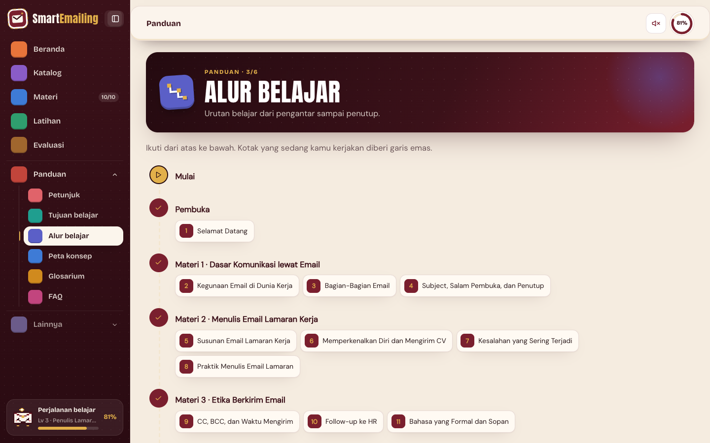

## Isi di dalam web

### Menu samping, tombol kanan atas, dan halaman Lainnya
Semua halaman punya menu samping berwarna marun dengan **ikon piksel buatan sendiri**: Beranda, Katalog, Materi, Latihan, Evaluasi, lalu grup **Panduan** (Petunjuk, Tujuan belajar, Peta konsep, Glosarium) dan **Lainnya** (Progres belajar, Tentang & tim) yang bisa dibuka-tutup. Di bawah menu ada kartu **Perjalanan belajar** (maskot Surti, level, dan persen progres). Menu bisa diciutkan jadi ikon saja, dan di HP jadi laci yang dibuka dengan tombol ☰.

Di kanan atas ada tombol efek suara, lingkaran **progres** (klik untuk ringkasan), dan tepat di sampingnya ikon gerigi **Pengaturan**. Ikon **?** kecil di pojok kanan bawah membuka halaman **FAQ**.

- **Progres belajar** (`#/progres`): rute pos berisi 5 perangko level dengan pesawat kertas di posisimu, tugas minggu ini, koleksi 11 segel lilin (klik untuk melihat syarat dan progresnya), asal XP, dan sertifikat. Semua dihitung dari data asli.
- **Pengaturan** (`#/pengaturan`, ikon gerigi di kanan atas): efek suara, menu ringkas, kurangi animasi, dan satu-satunya tombol **Reset progres**. Sebelum dihapus ada konfirmasi, lalu semua data (termasuk nama) kembali ke kondisi awal.
- **FAQ** (`#/faq`, ikon ? di kanan bawah): tanya-jawab per kategori.
- **Tentang & tim** (`#/tentang`): judul proyek, tujuan umum, isi pelatihan, format interaksi, tim, dan teknologi.

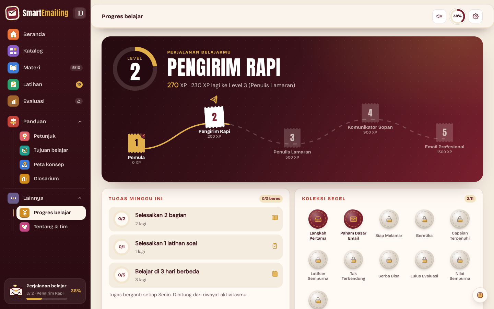

### 1. Beranda dan katalog materi

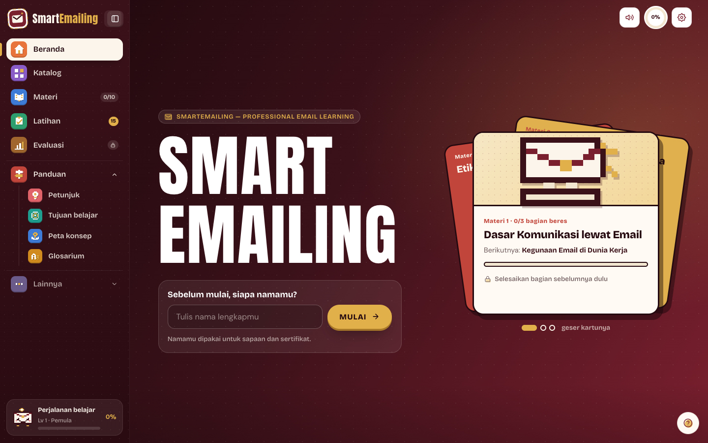

Saat pertama dibuka, Beranda meminta **nama** peserta. Materi, latihan, dan evaluasi baru bisa dibuka setelah nama diisi. Nama ini dipakai untuk sapaan dan sertifikat, dan bisa diganti lewat ikon pensil di samping sapaan.

Setelah itu Beranda menampilkan sapaan sesuai jam perangkat (**Selamat pagi/siang/sore/malam, [Nama]**), judul besar **SMART EMAILING**, tombol **Lanjut belajar** yang langsung membuka bagian terakhir, dan tumpukan kartu Materi 1–3 yang bisa digeser, lengkap dengan progres dan bagian berikutnya. Halaman **Materi** menampilkan ketiga materi beserta bagiannya. Bagian yang sudah selesai diberi tanda centang, dan bagian yang masih terkunci diberi gembok.

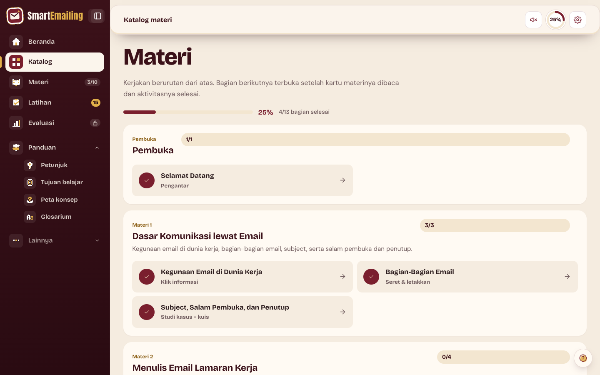

### 2. Halaman belajar
Setiap bagian ditampilkan seperti email masuk, dengan progress bar posisi belajar di bagian atas. Isi setiap halaman belajar:
- **Tujuan** bagian tersebut dalam bentuk catatan tempel
- **Materi** yang dibaca per kartu (Bagian 1, 2, …)
- **Aktivitas**. Tombol *Lanjut* baru aktif setelah aktivitasnya selesai.

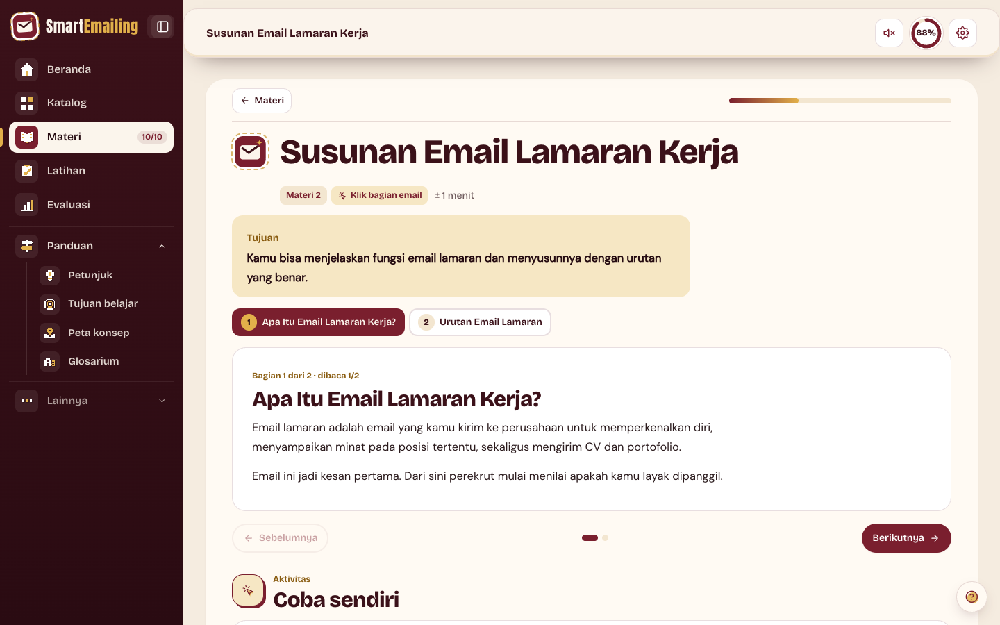

### 3. Aktivitas interaktif
Setiap bagian memakai jenis aktivitas yang berbeda, dan semua jawaban tersimpan otomatis.

| Seret & letakkan | Temukan kesalahan |
|---|---|
| 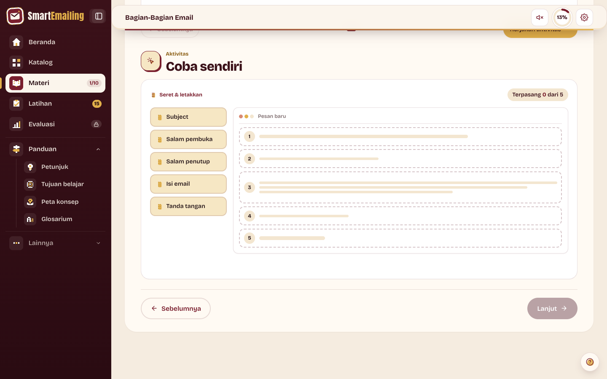 | 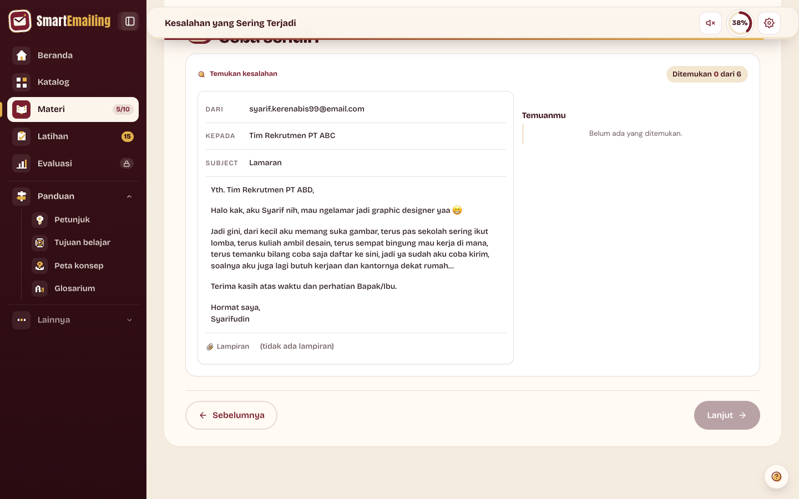 |

| Bagian | Aktivitas |
|---|---|
| Selamat Datang | Pengantar: contoh email sebelum dan sesudah + peta materi |
| Kegunaan Email di Dunia Kerja | Klik informasi |
| Bagian-Bagian Email | Seret & letakkan |
| Subject, Salam Pembuka, dan Penutup | Studi kasus + kuis |
| Susunan Email Lamaran Kerja | Klik bagian email |
| Memperkenalkan Diri dan Mengirim CV | Simulasi menulis email |
| Kesalahan yang Sering Terjadi | Temukan 6 kesalahan |
| Praktik Menulis Email Lamaran | Form + daftar periksa + contoh jawaban |
| CC, BCC, dan Waktu Mengirim | Animasi + atur jam + kuis |
| Follow-up ke HR | Pilih langkahmu |
| Bahasa yang Formal dan Sopan | Pilih kalimat yang tepat |

### 4. Latihan soal
15 soal pilihan ganda dari storyboard dibagi jadi **Latihan Materi 1, 2, dan 3** (5 soal per materi). Halaman **Latihan** (`#/latihan`) menampilkan kartu setiap latihan dengan status *Belum mulai / Sedang dikerjakan / Selesai*, nilai terakhir, dan progres, ditambah kartu tiga aktivitas interaktif.

- **Layar kuis** memakai seluruh layar: satu soal per tampilan, progress bar, navigator nomor soal (sudah dijawab, belum dijawab, sedang aktif), Sebelumnya/Berikutnya (juga tombol panah ← →), dan **Selesai**. Pembahasan langsung muncul setelah menekan **Jawab**, lengkap dengan tautan ke bagian materi terkait.
- **Layar hasil:** nilai, jumlah benar/salah, persentase, waktu pengerjaan, status *Capaian terpenuhi* (≥ 70%), dan tombol Review jawaban, Ulangi, dan Daftar latihan.
- **Review jawaban:** jawabanmu, jawaban yang tepat, dan pembahasan setiap soal dari percobaan terakhir.
- Jawaban, nilai, riwayat percobaan, dan posisi soal tersimpan, jadi aman walau halaman di-refresh. Syarat evaluasi tetap minimal 11 dari 15 benar.

| Daftar latihan | Layar kuis | Hasil |
|---|---|---|
| 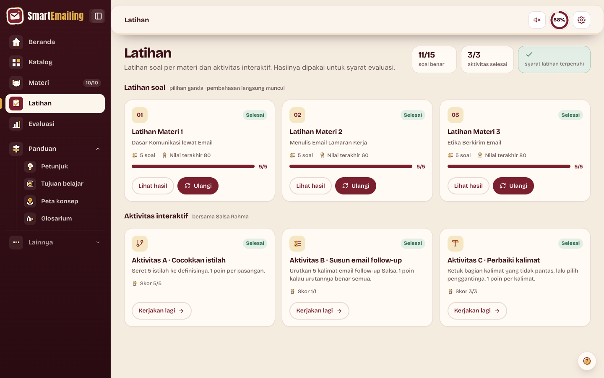 | 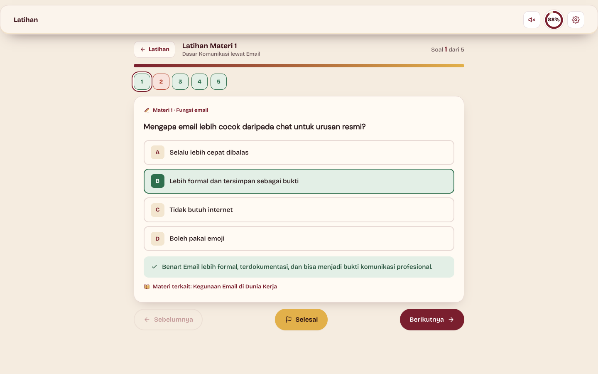 | 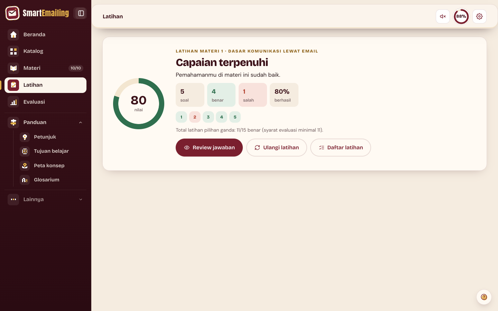 |

### 5. Aktivitas interaktif
Tiga aktivitas dalam satu layar kartu, dengan tokoh **Salsa Rahma** yang melamar posisi Content Writer. Ketiganya harus dikerjakan.
- **A. Cocokkan istilah:** seret 5 istilah (subject line, CC, BCC, follow-up, signature) ke definisinya. 1 poin per pasangan.
- **B. Susun email follow-up:** urutkan 5 kalimat email follow-up Salsa. 1 poin kalau urutannya benar semua.
- **C. Perbaiki kalimat:** ketuk bagian kalimat yang tidak pantas, lalu pilih penggantinya dari 3 opsi. 1 poin per kalimat.

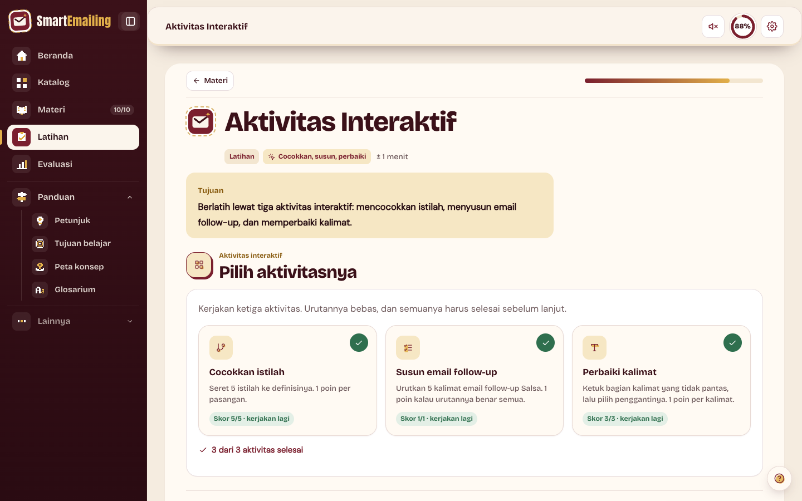

### 6. Awal evaluasi dan evaluasi akhir
- **Awal Evaluasi** adalah pos pemeriksaan: panel besar "SIAP EVALUASI?" dengan cincin x/3 syarat, lalu 3 kartu syarat bernomor (materi selesai, latihan minimal **11 dari 15 benar**, 3 aktivitas interaktif) dengan progress bar dan tombol **Kerjakan** ke bagian yang kurang. Tombol **Mulai evaluasi** baru menyala setelah ketiganya terpenuhi.
- **Evaluasi Akhir** berjalan dalam mode ujian layar penuh (menu samping disembunyikan). Sebelum soal pertama ada layar **Aturan main** berisi 4 kartu.
- Ada **4 soal** dari interaksi di materi: seret & letakkan bagian email, pilih subject, tandai kesalahan, dan pilih kalimat formal. Setiap soal punya kotak **Cara menjawab**.
- Tidak ada tanda benar/salah. Tombol **Simpan jawaban** memunculkan konfirmasi dulu, karena jawaban yang sudah disimpan tidak bisa diubah.
- Layar hasil hanya menampilkan nilai dan status **Lulus** atau **Belum lulus** (batas **75**), dengan langkah berikutnya: Penutup dan Sertifikat, atau Pelajari ulang dan Coba lagi.

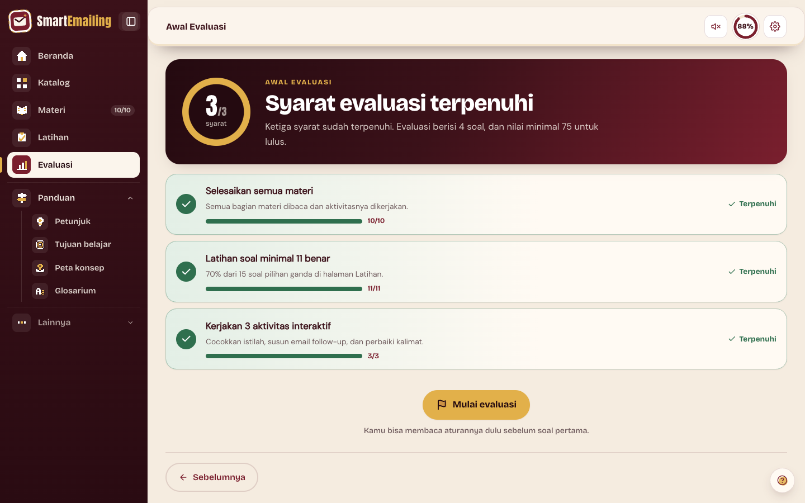

| Mengerjakan evaluasi | Hasil evaluasi |
|---|---|
| 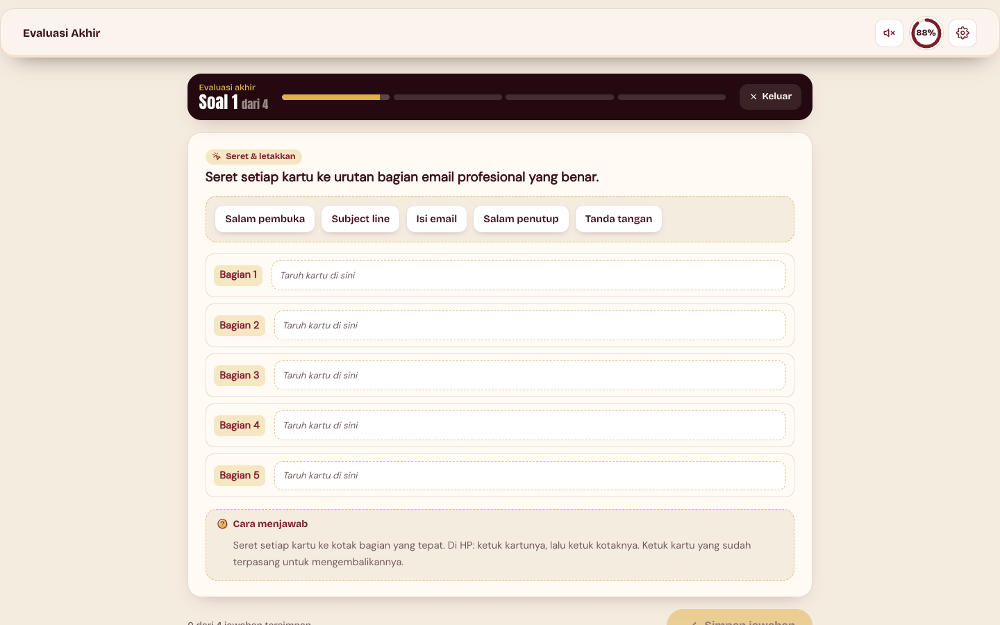 | 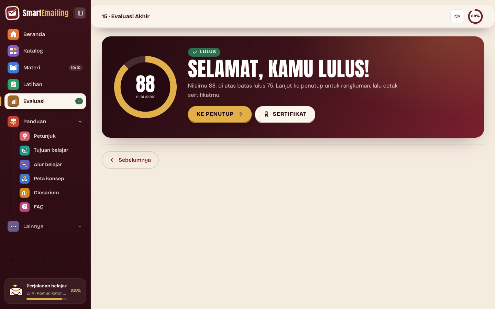 |

### Panduan
Empat halaman Panduan memakai kepala halaman yang sama dan tombol Sebelumnya/Berikutnya di bawah:
- **Petunjuk:** 4 langkah memakai web, dan **kode interaksi** yang bisa dicoba langsung (Normal, Hover, Hit, Swipe, Seret & letakkan, Show).
- **Tujuan belajar:** tujuan umum, 7 tujuan khusus, dan tujuan tiap bagian yang dikelompokkan per materi.
- **Peta konsep:** peta isi pelatihan dengan cabang per materi.
- **Glosarium:** pencarian dan indeks A–Z.

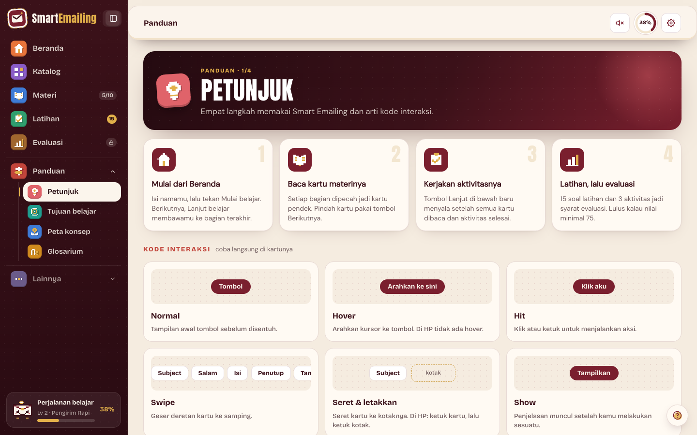

### 7. Penutup
Terbuka setelah peserta lulus evaluasi. Isinya rangkuman satu halaman yang bisa disimpan sebagai PDF, ditambah formulir masukan (rating bintang dan saran).

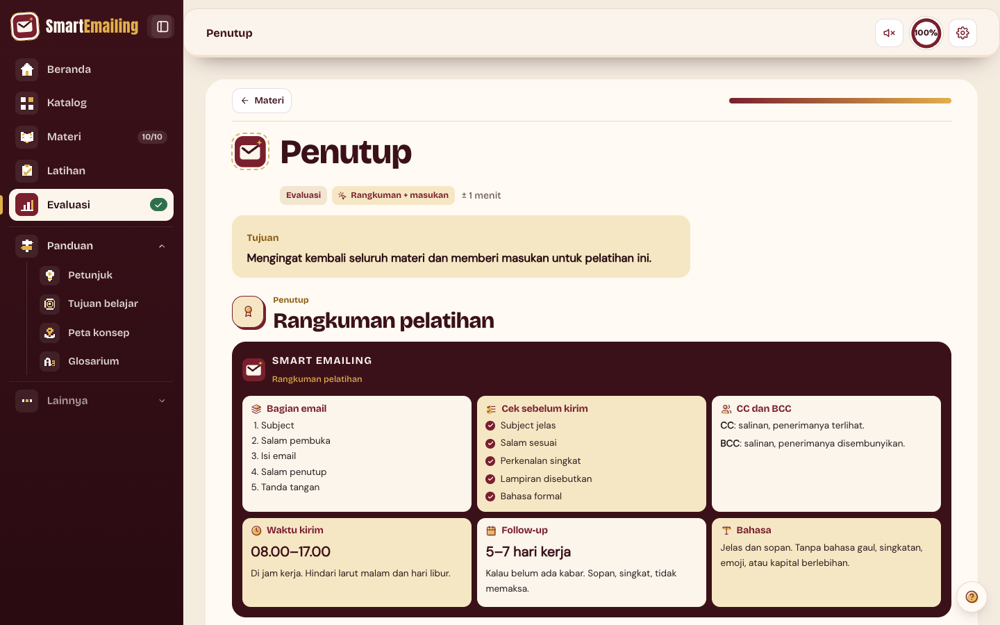

### 8. Tampilan di HP
Di HP, semua halaman tampil layar penuh dan menu dibuka lewat tombol ☰. Seret & letakkan diganti dengan *ketuk kartu, lalu ketuk slotnya*.

<p align="center">
  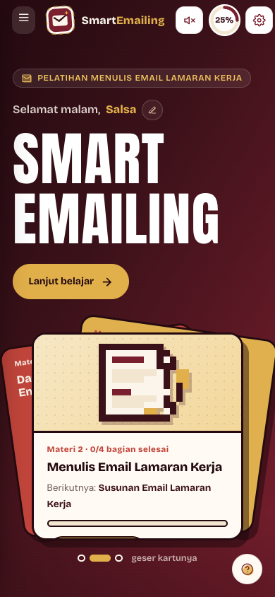
  &nbsp;&nbsp;
  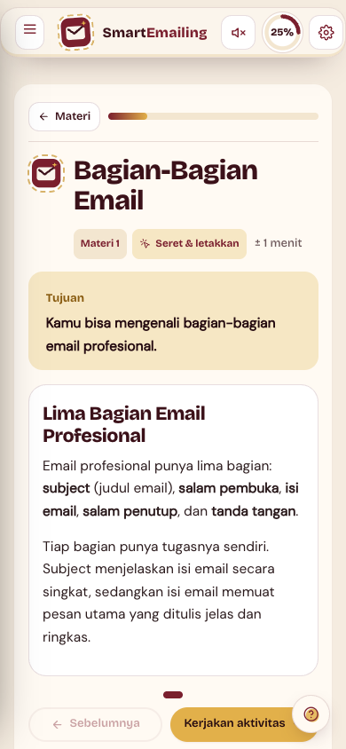
</p>

### 9. Materi terbuka berurutan
Setiap bagian baru terbuka setelah bagian sebelumnya selesai, termasuk latihan soal dan aktivitas interaktif. Selesai artinya **semua kartu materinya sudah dibaca** dan **aktivitasnya sudah dikerjakan**. Kartu yang sudah dibaca diberi tanda centang, dan tombol *Lanjut* menjelaskan apa yang masih kurang. Bagian yang belum terbuka ditandai gembok di halaman Katalog.

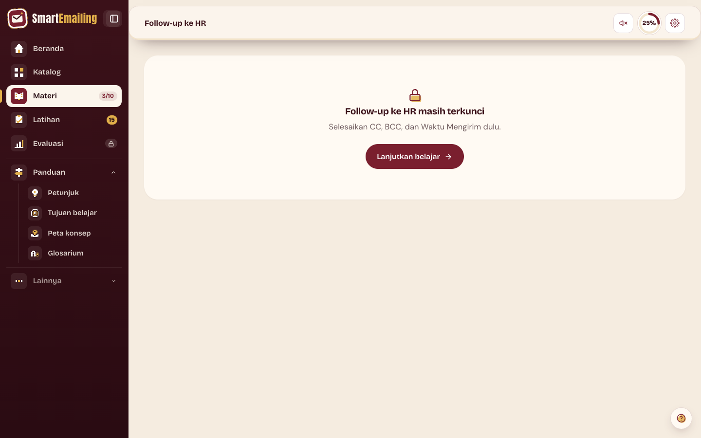

### 10. Gamifikasi: skor, level, segel, dan reward
| Unsur | Isinya |
|---|---|
| **Skor (XP)** | Pengantar 20 · setiap bagian materi 50 · setiap soal latihan benar 20 · bonus combo latihan 10 × combo terbaik · setiap aktivitas interaktif 30 · nilai evaluasi × 3 · bonus lulus 100 · penutup 30 (maksimal 1.490 XP) |
| **Level** | 1 Pemula → 2 Pengirim Rapi (200) → 3 Penulis Lamaran (500) → 4 Komunikator Sopan (900) → 5 Email Profesional (1.300), ditampilkan sebagai rute pos dengan perangko |
| **11 segel** | Langkah Pertama, Paham Dasar Email, Siap Melamar, Beretika, Capaian Terpenuhi, Latihan Sempurna, Tak Terbendung (combo 5×), Serba Bisa, Lulus Evaluasi, Nilai Sempurna, Memberi Masukan |
| **Mingguan** | Tugas minggu ini: 2 bagian, 1 latihan, dan belajar di 3 hari berbeda (dihitung dari riwayat aktivitas) |
| **Reward** | Kartu "Lencana baru!" dan "Naik level!", konfeti, combo saat latihan, dan **sertifikat** bernama peserta setelah lulus evaluasi |

## Fitur lain
- **Satu sumber data** di localStorage (`smart-emailing:v2`) untuk Beranda, Latihan, Progres, dan Evaluasi; data lama tetap terbaca.
- **Progres tersimpan otomatis** di browser: bagian selesai, kartu yang sudah dibaca, jawaban setiap aktivitas, latihan, evaluasi, skor, dan lencana. Pindah halaman tidak menghapus apa pun.
- **Cincin progres dan badge** di navbar: persentase belajar, jumlah soal latihan yang belum dikerjakan, dan status evaluasi.
- **Panduan** dalam satu halaman bertab: Cara pakai dan arti kode interaksi (*Normal, Hover, Hit, Swipe, Seret & letakkan, Show*), Tujuan belajar per bagian, Flowchart, Peta Konsep, dan Glosarium yang bisa dicari.
- **Animasi**: transisi berbeda untuk setiap jenis halaman, ikon yang bergerak saat diklik, efek suara klik dan benar/salah (bisa dimatikan), serta konfeti saat bagian selesai.
- **Tanpa tautan luar**: semua aset ada di dalam web, jadi bisa dipakai tanpa internet.
- **Warna**: marun, krem, dan emas.

## Teknologi
- **HTML, CSS, dan JavaScript murni** tanpa framework dan tanpa library luar, jadi ringan dan bisa berjalan offline.
- **Single Page Application** dengan router berbasis hash (`#/bagian/S04`, `#/latihan`, …).
- **localStorage** untuk menyimpan progres dan jawaban di perangkat peserta.
- **SCORM 1.2 API** untuk mengirim status dan nilai ke LMS.
- **Web Audio API** untuk efek suara dan **Web Animations API** untuk transisi halaman.
- **Build script Python** (`tools/build.py`) yang menggabungkan semua file menjadi satu HTML offline beserta paket ZIP dan SCORM.

## Cara memakai

| Cara | Langkah |
|---|---|
| **Online** | Buka https://syahladfa.github.io/SmartEmailing/ |
| **Offline** | Unduh `dist/SmartEmailing_Tim7_offline.html`, lalu klik dua kali. Tidak butuh internet. |
| **LMS (Moodle, dll.)** | Unggah `dist/SmartEmailing_Tim7_SCORM.zip` sebagai aktivitas SCORM (*Add an activity → SCORM package*). Status belajar dan nilai evaluasi otomatis tercatat di LMS, dan peserta dinyatakan lulus bila nilainya ≥ 75. |
| **Folder web** | `dist/SmartEmailing_Tim7.zip` untuk aktivitas *Folder* / *IMS content*. |

## Untuk tim: cara update web
Setelah mengedit file, pilih salah satu cara:
1. Klik dua kali **`Update ke GitHub.command`** di Finder. Paket offline, ZIP, dan SCORM dibuat ulang, lalu diunggah.
2. Klik dua kali **`Sinkron Otomatis.command`** dan biarkan jendelanya terbuka. Setiap file yang disimpan otomatis diunggah 10 detik kemudian.
3. Lewat Terminal: `./tools/publish.sh "pesan perubahan"`.

GitHub Pages memperbarui web sekitar 1–2 menit setelah unggahan.

<details>
<summary><b>Struktur folder</b></summary>

```
SmartEmailing_Tim7/
├── index.html          ← halaman utama (dipakai GitHub Pages)
├── css/styles.css      ← tampilan (marun · krem · emas)
├── js/app.js           ← isi materi, bagian belajar, aktivitas, latihan, evaluasi
├── assets/img/         ← logo dan favicon
├── docs/screenshots/   ← foto tampilan untuk README ini
├── tools/build.py      ← membuat paket offline, ZIP, dan SCORM di dist/
├── tools/publish.sh    ← build + commit + unggah ke GitHub
├── tools/autosync.py   ← unggah otomatis setiap file disimpan
├── Update ke GitHub.command / Sinkron Otomatis.command ← klik dua kali di Finder
├── CHECKLIST_AUDIT_INTERNAL.md
└── dist/               ← paket siap kirim (offline .html, .zip, SCORM .zip)
```
</details>

## Riwayat versi
Lihat halaman [Releases](https://github.com/syahladfa/SmartEmailing/releases) untuk catatan setiap versi dan file unduhannya.

---
<div align="center"><sub>Smart Emailing · Kelompok 7 · Seluruh materi disusun dari dokumen desain tim.</sub></div>
